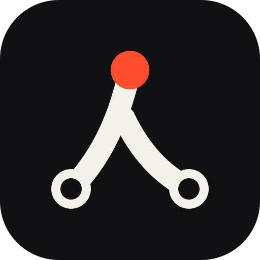

<p align="center">
  
</p>

<h1 align="center">Siljangnim</h1>

<p align="center">
  A creative coding studio run by an agent.<br/>
  Make live visuals by describing them, reshape them in conversation, mix pieces together,<br/>
  play them live with MIDI, OSC and sound, and export them as video.
</p>

<p align="center">
  <a href="#get-started">Get started</a> ·
  <a href="https://siljangnim.vercel.app/">Try on the web</a> ·
  <a href="docs/en/creative.md">Guides</a> ·
  <a href="README.ko.md">한국어</a>
</p>

<p align="center">
  <a href="https://cdn.jsdelivr.net/gh/okdalto/siljangnim@df9822e1e6/media/siljangnim-short.mp4"></a><br/>
  <a href="https://cdn.jsdelivr.net/gh/okdalto/siljangnim@df9822e1e6/media/siljangnim-short.mp4">▶ Watch with sound (39 s, English narration, Korean and English subtitles)</a>
</p>

Siljangnim promo Shorts are made with [Siljangnim Shorts](https://github.com/okdalto/siljangnim-shorts).

---

## Get started

> **We recommend the desktop app (A).** The web version is fine for looking at the examples, but Siljangnim is
> built for an agent that installs and runs open-source tools on your machine — Python packages, ffmpeg, ML
> models, OSC — and the web can't do any of that. In the app, the chat runs on your own Claude Code or Codex, so it
> uses your Claude or ChatGPT plan instead of a separate API key.

Pick one. Each takes about a minute.

### A. Desktop app — recommended

**Updates (0.2.11+):** Settings → App updates → Check for updates. Download opens the matching installer in your browser; quit the app and install it manually.

1. Download the installer from **[Releases](https://github.com/okdalto/siljangnim/releases/latest)**: `.dmg` for macOS (Apple Silicon), `.exe` for Windows.
2. Open Siljangnim, then **Settings** (gear icon) → **Agent**:
   - **Claude Code** or **Codex** — runs on your Claude (Pro, Max, Team) or ChatGPT plan, no API key. If it isn't
     installed or signed in yet, the **Install** and **Sign in** buttons there do it.
   - **API key** — an Anthropic or OpenAI key, encrypted with the OS keychain; it never reaches the app window.
3. Type what you want in the chat:

```text
Glowing jellyfish drifting in a dark sea, with a slider for how many there are.
```

The installers aren't code-signed yet, so the first launch needs one extra step: on macOS, *System Settings →
Privacy & Security → Open Anyway*; on Windows, *More info → Run anyway*.

<details>
<summary>Run from the source instead</summary>

```bash
git clone https://github.com/okdalto/siljangnim.git && cd siljangnim && npm install && npm run dev
```

Next time, `npm run dev` in that folder (or `./run.sh`, `run.bat`) is enough. To build an installer for your own
machine: `npm run dist` (output in `desktop/release/`).

</details>

### B. From Claude Code or Codex in a terminal

Paste this into **Claude Code**:

```text
Install the Siljangnim MCP server by running:
claude mcp add siljangnim -- npx -y siljangnim-mcp@latest
Then tell me to restart Claude Code.
```

For **Codex**, run this one command in your normal terminal (outside the agent):

```bash
npx -y siljangnim-mcp@latest setup codex
```

It checks Node.js and the Codex CLI, registers the server, verifies the MCP connection and opens a test viewer.
No manual configuration edit is needed. The temporary test session closes after verification; close that tab,
then fully quit and restart Codex. A new viewer opens automatically when Codex starts its MCP server.
You can rerun setup to update the registration. A successful setup checks the package, not the current Codex conversation.

Restart it, then ask for something:

```text
Use siljangnim to make glowing jellyfish drifting in a dark sea, with a slider for how many there are.
```

A viewer window opens (an app window in Chrome or Edge, or a browser tab) and the scene appears there. If the
desktop app is open, its window is used instead. Keep chatting with your agent to change it.

You need [Node.js 22 or newer](https://nodejs.org). Nothing else: the first time a tool needs Python, it is
downloaded into `~/.siljangnim/runtime/`.

<details>
<summary>Cursor, Claude Desktop and other MCP clients; Codex by hand</summary>

**Codex** (instead of `codex mcp add`) — add to `~/.codex/config.toml`:

```toml
[mcp_servers.siljangnim]
command = "npx"
args = ["-y", "siljangnim-mcp@latest"]
```

**Cursor, Claude Desktop, Windsurf and others** — add to the client's MCP settings
(`.cursor/mcp.json`, `claude_desktop_config.json`, …):

```json
{
  "mcpServers": {
    "siljangnim": { "command": "npx", "args": ["-y", "siljangnim-mcp@latest"] }
  }
}
```

Options (port, which browser opens) are in [docs/en/mcp.md](docs/en/mcp.md). To remove it:
`claude mcp remove siljangnim`.

</details>

### C. In your browser — nothing to install

Open **[siljangnim.vercel.app](https://siljangnim.vercel.app/)**, then:

1. Click **Examples** (top right) and open any example — it runs right away.
2. To make your own, open **Settings** (gear icon) and paste an Anthropic or OpenAI API key.
   It stays in that browser tab and goes only to the model provider.
3. Type what you want in the chat.

The web version can't run tools on your computer (Python packages, ffmpeg, ML models, OSC), so most of what
the agent can do needs A or B. Use the web to look around; use the app to make things.

## What you can do

Siljangnim isn't a gallery of demos to download and run. It's a studio: you set the direction, the agent
writes the code, and the work keeps changing for as long as you keep talking to it.

- **Make it by describing it** — "glowing jellyfish drifting in a dark sea", "a hatching drawing of this photo,
  denser where it's closer". The agent picks the tools (shaders, physics engines, geometry libraries, Python
  packages, ML models), writes a WebGL2 or WebGPU scene, fixes its own errors and looks at the result before answering.
- **Bring open Shadertoy code** — paste a shader that carries an open license (MIT, CC0, …) and it runs as
  written, buffers and channels included; the agent keeps the credit and won't port non-open ones.
- **Shape it in conversation** — "slower, sunset colors", "twice the particles", "give me a slider for that".
  Anything you want to play with becomes a control: sliders, knobs, 2D pads, menus, buttons, colors. Every
  change is a version you can go back to and branch from, and you can read the code it wrote.
- **Technique suggestions and a remix list** — **Try next** cards suggest techniques that fit what's on screen, and
  the full list lets you pick several of 46 techniques (SSAO, instancing, perspective warp, volumetric rendering, PBR,
  path tracing, Gaussian splatting, pixel sorting, datamosh, beat sync…) and examples to mix in at once.
- **Mix pieces together** — drag an example card onto the mix bar (or press **Mix in**): its scene and assets come
  into your project and the agent blends the two into one image. Or paste a piece someone shared and ask for a mashup.
- **Play it live** — mouse, keyboard, microphone and audio files, camera, MIDI controllers and OSC (TouchOSC,
  Ableton, TouchDesigner). Ask the agent to wire knob 1 to color; press **Perform** to send the scene full
  screen to a projector. Or switch to **Timeline** and keyframe the controls.
- **Frame it** — landscape, portrait (9:16), square, or an exact size like 1080×1920 or 4K from the frame menu; scenes
  re-fit when the size changes mid-run.
- **Export it** — MP4, WebM or PNG frames: frame-exact offline renders at any size (vertical 1080×1920, 4K), or
  a realtime capture of what you played. The intro video above was recorded from the examples this way.
- **Pass it on** — a project exports as `project.md`: what was asked, which tools were used and how. Another
  person's agent rebuilds it from that, and keeps remixing.

Start from one of **397 examples**, each built on an open-source project (Shan Shui Infinite, MarkovJunior,
Growing NCA, Three.js, p5.js, OpenCV, librosa …) with its credits and license, and take it somewhere else.

[A longer walk-through of the creative workflow](docs/en/creative.md).

## Under the hood

- *Siljangnim* (실장님) is what Korean design studios call the person who runs the floor: you say what you want,
  and they know which people and tools to bring in.
- **Open-source tools on your machine** — Python packages run in isolated environments and installed programs
  (ffmpeg, Blender, …) run after you approve. What worked is saved as a recipe, so next time it's instant, and
  recipes are shared through [registry/](registry/).
- **Bring your own agent** — Claude Code, Codex, Cursor or any MCP client drives the same studio as the built-in
  agent, which runs on Anthropic (Claude Opus 5.5 by default) or any OpenAI-compatible server (OpenAI, vLLM, Ollama, …).
- **Isolated scenes** — scene code runs on a separate origin and can't reach your projects or keys.

## For developers

```bash
npm install
npm run web      # the studio at http://localhost:5173
npm run dev      # the desktop app with hot reload
```

| Command | What it does |
|---|---|
| `npm run check` | Typecheck and lint |
| `npm test` | Studio, MCP bridge and hub tests |
| `npm run smoke` | Launch the desktop app, run an agent session against a mock API and open every example; then drive the viewer through the MCP bridge |
| `npm run mcp` | The MCP server from this checkout (`claude mcp add siljangnim -- node "$PWD/mcp/bin/siljangnim-mcp.js"` after `npm --prefix studio run build`) |
| `npm run dist` | Installer for the current platform into `desktop/release/` (CI builds both platforms on a `v*` tag) |
| `npm run notices` | Regenerate `THIRD_PARTY_NOTICES.md` |


Examples fetch files on first use and cache them in IndexedDB. Development/local builds serve separate files under
`example-library/`; installer CI uses the matching commit on GitHub, excluding example payloads and thumbnails
from installers. The MCP package (`npm --prefix mcp pack`/`publish`) does the same: it points at
`https://raw.githubusercontent.com/okdalto/siljangnim/<commit SHA>/examples` for the current commit, so packing
stops if `examples/` has uncommitted changes or the commit is not on GitHub yet. For a lightweight custom
installer, set `SILJANGNIM_EXAMPLES_BASE_URL` to that URL for an **already published commit**, then run
`npm run dist`. Other HTTPS hosts must allow CORS and serve the same directory layout. Remote files must match the
checkout; mismatches fail integrity checks. Omitting the variable for an installer, or setting
`SILJANGNIM_EXAMPLES_BASE_URL=local` for the MCP package, produces a self-contained build with local example files.

```
studio/     The app: React + TypeScript UI, built-in agent, isolated scene runtime
desktop/    Electron shell: window, app:// protocol, key storage, hub process, installers
hub/        Python sidecar (uv-managed): runtime jobs and recipes
mcp/        MCP server for external agents (published as siljangnim-mcp)
examples/   Example projects shown in the app
registry/   Shared recipes, contributed by pull request
docs/       User guides (Korean; English in docs/en/)
```

Guides: [the creative workflow](docs/en/creative.md), [connecting an agent](docs/en/mcp.md), [tools on your machine](docs/en/local-tools.md), [sharing](docs/en/sharing.md), [models](docs/en/models.md).

## Costs and security

- **Cost** — cloud models bill per token. A complex scene can take many rounds; one conversation can cost
  a few dollars. With Claude Code you use your Claude plan; self-hosted models have no per-token cost.
- **Security** — scene code runs on a separate origin and can't reach your projects or keys. Running code
  or installing packages on your machine asks first; it isolates files and dependencies, but it is not an
  OS sandbox. Everything local listens on 127.0.0.1 only — don't expose it to the network.

## Thanks

Thanks to 현 (@hyun2xyz) for [index.opensource](https://indexopensource.com/index),
the open-source index Siljangnim's catalog of tools started from, and to everyone whose open-source work the
examples are built on.

## License

[GPL-3.0](LICENSE). Third-party code, tools and material, with licenses and source links:
[THIRD_PARTY_NOTICES.md](THIRD_PARTY_NOTICES.md).
